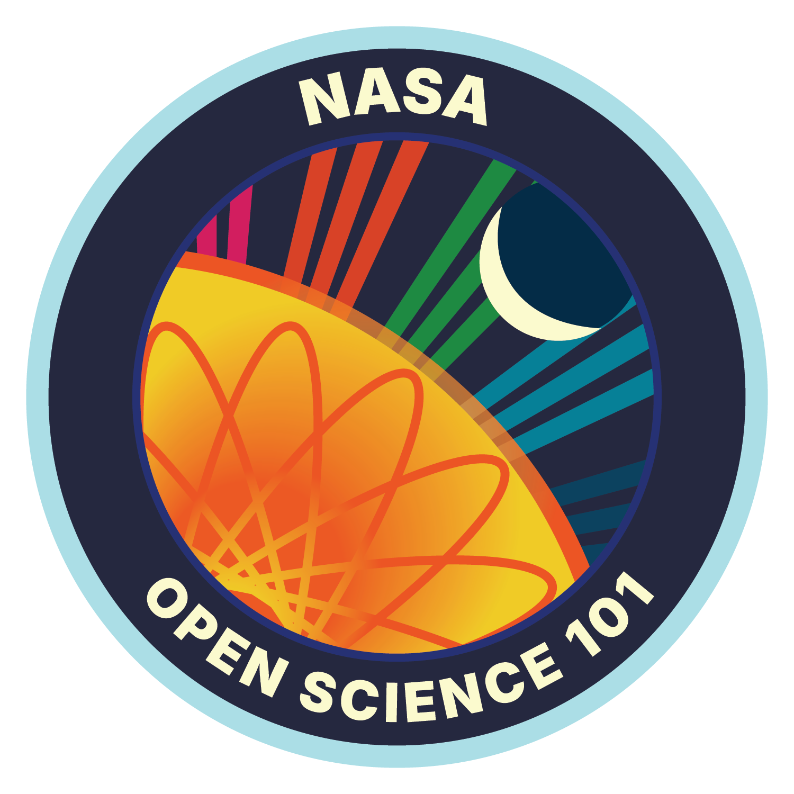

# 🌌 Debapriyo Mukherjee
### *Frontend Developer & NASA-Certified Open Science Enthusiast*
📍 Hooghly, West Bengal, India 🇮🇳

---

## 📈 Executive Summary
A technically driven Class 10 student (WBBSE) combining engineering logic with modern frontend development. Recognized by NASA for curriculum completion in open-source research frameworks and active in digital deep-space exploration communities. Deployed highly functional, responsive web infrastructure projects under structural performance constraints.

---

## 🚀 NASA Credentials & Credentials Vault

| Credential Name | Verification Document | Official Visual Verification |
| :--- | :--- | :--- |
| **NASA Open Science 101 Curriculum** | 📄 [OpenScience101_2026.pdf](./OpenScience10120260823-8-k0mtg2.pdf) |  |
| **SpaceX Crew-13 Virtual Passenger** | 📄 [Crew-13_Stamp.pdf](./Stamp_Crew-13_Final.pdf) |  |
| **Nancy Grace Roman Space Telescope** | 📄 [Roman_Telescope.pdf](./Telescope_Final.pdf) |  |

---

## 💻 Flagship Engineering Deployment

### 🌐 [Digsui Sadhana Banga Vidyalaya Portal](https://github.io)
> **Project Role:** Lead Creator & Frontend Architect

A comprehensive digital gateway built directly for my academic institution to streamline communication and school broadcasts.

- **System Architecture:** Clean semantic HTML5, adaptive structural CSS3 sheets, responsive layout breakpoints.
- **Integrated Utilities:** Full client-side Dark Mode toggles, dynamic live announcement queues, and automated cross-linking to institutional digital channels.
- **Resource Management:** Optimized media handling to ensure fast load speeds over standard regional networks.

---

## 🛠️ Technical Competency & Linguistic Stack

### **Development Frameworks**
- **Core Languages:** HTML5 `||` CSS3 `||` Fundamentals of Python Programming
- **Systems & Automation:** GitHub Page Deployments, Version Control, Advanced Prompt Engineering 
- **Analytical Operations:** Mathematical Logic, Advanced Spreadsheets (Google Sheets/Excel)

### **Linguistic Capabilities**
- 🗣️ **Bengali** (Native Fluency)
- 🇬🇧 **English** (Professional & Technical Application)
- 🇮🇳 **Hindi** (Conversational Proficiency)
- 📜 **Sanskrit** (Academic & Analytical Translation)

---

## 📫 Communication Channels
- 📧 **Direct Professional Mail:** debopriyomukherjee712148@gmail.com
- 🏢 **Academic Affiliation:** Digsui Sadhana Banga Vidyalaya (H.S.)
